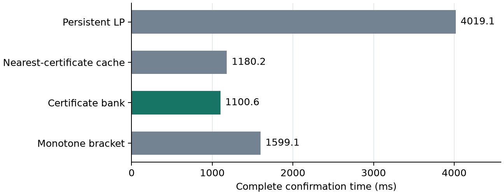

# Data-center restoration certificates

Research code for **Reusing Feasibility Certificates for Data-Center Restoration with Migration Energy and Downtime**, by Dongyue Kan. The experiment checks whether a data center can postpone workload migration during an outage and still satisfy a service-loss budget. It accounts for UPS energy, migration energy, migration downtime, cooling availability, and delayed recovery messages.

The implementation builds a causal reference linear program with HiGHS. Across battery-energy and migration-cost queries for a fixed model, the certificate bank repairs stored primal policies and re-evaluates dual multipliers against the changed constraint matrix. A bound resolves a query when it separates the loss budget. The persistent LP handles ambiguous queries.

## Quick start

Use Python 3.12 in a new environment. The requirements record the versions used to verify the numerical benchmark.

```bash
python3.12 -m venv .venv
source .venv/bin/activate
python -m pip install -r requirements.txt
python experiment.py --split smoke --output generated/smoke
```

The smoke run compares four methods on 64 synthetic queries drawn from two recovery profiles with three and nine trajectories. It prints the disagreement count and writes per-query and per-method CSVs. A successful run reports zero disagreements with the full LP.

## Reproduce the confirmation experiment

```bash
python experiment.py --split confirmation --output generated/confirmation
python audit.py --output generated/confirmation
python report.py --results generated/confirmation
```

The full run generates 24 synthetic recovery profiles, 96 LP models, and 12,288 parameter queries. The audit adds 3,072 requests close to the LP decision boundary, checks the repaired witnesses, evaluates the impact of omitting migration energy and downtime, and measures shared model construction. Run the experiment serially on an idle machine for comparable timing measurements.

To repeat the development comparison, run `python experiment.py --split development --output generated/development`. The command uses the archived development seed and leaves the frozen confirmation selection intact.

## Inspect the original measurements

```bash
python report.py
```

This command verifies the included archive and recomputes the complete timing table. It uses the Python standard library and reads from `archive/`.

| Method | Complete time (s) | Certificate fallbacks |
| --- | ---: | ---: |
| Persistent LP | 4.0191 | — |
| Nearest-certificate cache | 1.1802 | 1,266 |
| All-certificate bank | 1.1006 | 606 |
| Monotone bracket | 1.5991 | 1,316 |

The complete timing includes 0.0682 s of shared model construction for each method. Certificate timings also include bank preparation and all fallback solves. The bank reduced archived total time by 72.62% relative to persistent LP and 6.74% relative to the nearest-certificate cache. The results are hardware-specific. All 12,288 ordinary queries and 3,072 boundary requests agreed with the reference. The bank routed 2,535 boundary requests to the LP.



To regenerate the chart, install the optional plotting dependency and supply a destination.

```bash
python -m pip install -r requirements-figures.txt
python report.py --figure generated/confirmation-runtime.png
```

## Files and provenance

| Path | Contents |
| --- | --- |
| `restoration.py` | Synthetic profile generator, shared-history LP, persistent solver, and certificate bounds |
| `experiment.py` | Seeded development, confirmation, and smoke experiments |
| `audit.py` | Boundary, repaired-policy, physical-model, and construction-cost checks |
| `report.py` | Archived-result validation, complete-cost summary, and optional chart |
| `protocol.json`, `frozen_selection.json` | Archived experiment configuration and development selection |
| `archive/` | Original input snapshots, individual queries and timing samples, validation results, and aggregation metadata |

The archive preserves the numerical files from the matching research experiment. The packaged runner uses the same model, solver tolerances, and seeded profiles. Its command-line interface writes new runs to a chosen directory. The timing calculation sums median per-model runs and adds shared model construction once per method. The accompanying alignment record documents the use of a fresh solver for query-audit witnesses and timed preparation.

The evaluation uses synthetic recovery trajectories and normalized resources. A bank applies to its fixed recovery support, observation histories, waiting deadline and migration downtime. Changing those inputs requires rebuilding it. The benchmark tests floating-point decisions over the declared domain using explicit solver tolerances.

Code citation metadata is in [`CITATION.cff`](CITATION.cff). The runtime dependencies come from their respective upstream Python packages.
